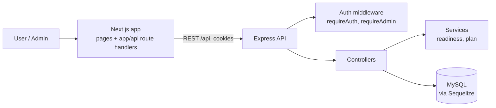

# SkillTrajectory

A skills-assessment and study-planning web app. Users take a test, get a readiness level and skill gaps, and receive a weekly study plan with milestones and progress tracking. Admins manage the question bank and view analytics.

> **Status: work in progress.**

## Tech stack

- **Back end:** Node.js, Express 5, Sequelize, MySQL, JWT auth (cookies), bcrypt
- **Front end:** Next.js 16 (App Router, TypeScript)

## Getting started

1. Create a MySQL database.
2. In `backend/`, create a `.env` with your own values (never commit it):

   ```
   DATABASE_URL=mysql://<user>:<password>@localhost:3306/<database>
   PORT=<port>
   JWT_SECRET=<long random string>
   JWT_EXPIRES_IN=7d   # optional, defaults to 7d
   ```
3. Run each part:

   ```bash
   cd backend && npm install && node Server.js
   cd frontend && npm install && npm run dev  # http://localhost:3000
   ```

The back end allows CORS from `http://localhost:3000` only.

## High-level design (HLD)



Main flow:

1. A user registers, logs in and saves a profile (target role, experience level, daily study minutes).
2. They start an attempt on the active test, answer questions and submit.
3. The API scores the attempt and returns a readiness level, skill gaps and a time estimate.
4. A weekly study plan is generated from the weak topics, with milestones.
5. The user updates progress against the plan from the dashboard.
6. Admins manage questions and see analytics.

## Low-level design (LLD)

### API (all under `/api`)

| Area | Endpoints |
| --- | --- |
| Auth | `POST /auth/register`, `POST /auth/login`, `GET /me` |
| Profile | `GET /profile`, `PUT /profile` |
| Tests and attempts | `GET /tests/active`, `POST /attempts/start`, `GET /attempts/:id/questions`, `POST /attempts/:id/answer`, `POST /attempts/:id/submit` |
| Results | `GET /attempts/:id/readiness`, `GET /attempts/:id/gaps`, `GET /dashboard/summary` |
| Plans | `POST /plans/generate`, `GET /plans/:planId`, `GET /plans/:planId/milestones`, `GET /plans/:planId/time-estimate` |
| Progress | `POST /progress/update`, `GET /progress/:planId` |
| Admin | `POST /admin/login`, `GET /admin/me`, `GET /admin/summary`, `GET /admin/analytics/summary`, CRUD on `/admin/questions` |

Protected routes use `requireAuth`; admin routes also use `requireAdmin`.

### Data model (Sequelize)

| Model | Key fields |
| --- | --- |
| `User` | `id`, `name`, unique `email`, `password_hash`, `role` (`USER` / `ADMIN`), `created_at` |
| `UserProfile` | `user_id`, `target_role`, `experience_level` (`BEGINNER` / `INTERMEDIATE` / `ADVANCED`), `daily_study_minutes`, `updated_at` |

Further tables (questions, attempts, plans, progress) are defined in `backend/src/db.js`.

### Services

- `readiness.service.js`: `calculateReadiness` turns score, accuracy and average time per question into a level (Beginner below 60%, Intermediate 60-79%, Interview-Ready 80% and above) and a 0-1 confidence score, with an explanation of the rule applied.
- `plan.service.js`: `buildTopicPriority` ranks weak topics; `generateWeeklyPlan` spreads them over a week using the daily study minutes.

### Structure

```
backend/
  Server.js              app setup, middleware, route mounting
  src/routes/            one router per area
  src/controllers/       request handlers
  src/middlewares/       auth, admin
  src/services/          readiness, plan
  src/db.js              Sequelize connection and models
frontend/
  app/                   pages (incl. /admin)
  app/api/               route handlers
```

## Development

Work is done in small stories on pull requests (S00-S03 so far). There are no automated tests yet.
